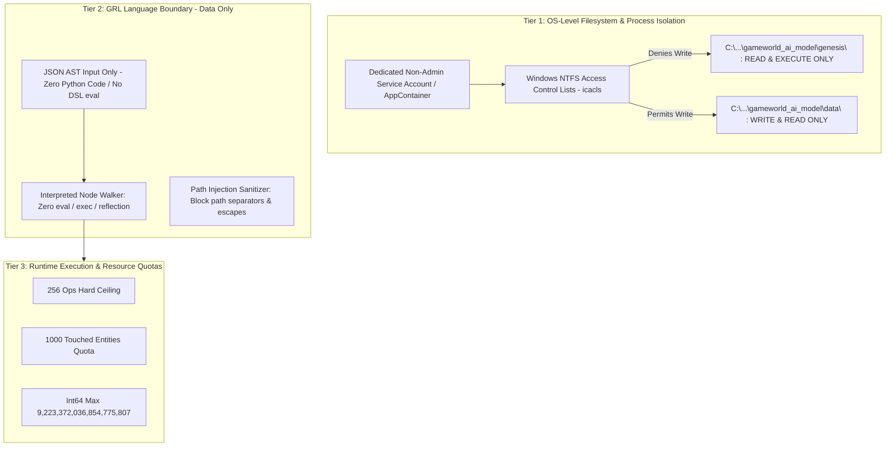

# GENESIS Alpha — Runtime Boundaries & Security Specification

**Version:** 3.1  
**Phase:** Phase 0 / Phase 1  
**Status:** Approved with Engineering Conditions  

---

## 1. Absolute Alpha Boundary Principle

The computational substrate of GENESIS is strictly frozen and human-maintained. GENESIS is an autonomous intelligence that defines and explores world dynamics *within* a strictly enforced digital physics engine, but it possesses **zero administrative authority** over the substrate itself.

> **Absolute Alpha Restriction:**  
> The runtime is frozen and human-maintained. GENESIS must not modify runtime source, the GRL interpreter, the execution engine, storage, its Python environment, execution limits, or its own model architecture, and must not execute unrestricted generated code or install unreviewed extensions.

---

## 2. Sandbox Enforcement Architecture on Windows

To make Acceptance Test 14 concrete and meaningful on Windows, the isolation architecture is defined across multiple operational tiers:

### 2.1 OS-Level Permissions on Windows
In a complete local deployment:
1. **Directory ACLs:** The `genesis/` runtime source tree has NTFS permissions configured (via `icacls`) granting the model process account `(RX)` (Read and Execute) only, with Write `(W)` and Delete `(D)` permissions explicitly stripped.
2. **Persistence Isolation:** The simulation engine is granted write permissions exclusively to designated subdirectories:
   - `data/snapshots/`
   - `data/events/`
   - `data/experiments/`
3. **Process Separation:** The LLM proposal generator operates in an independent process with zero IPC handles to the simulation runner beyond standard input/output JSON streams.

### 2.2 What the Python-Level Runtime Guarantees
Within the Alpha Python runtime, the following guarantees are mathematically enforced:
- **No Evaluation of Host Code:** The GRL interpreter contains zero calls to `eval()`, `exec()`, `compile()`, `ctypes`, `subprocess`, or `os.system`.
- **Pure Data Representation:** Rules are strictly parsed from JSON dictionaries against an explicit AST grammar. Unrecognized fields, non-whitelisted operator tokens, and arbitrary object structures fail immediately at parse time.
- **No Object Introspection / Prototype Pollution:** The interpreter does not access `__dict__`, `__class__`, `__globals__`, or `__subclasses__`. Entity property bags are primitive string-to-value dictionaries.
- **Path Sanitization:** String properties are validated and rejected if they contain path traversal sequences (`..`, `/`, `\`, `:`), preventing path injection.
- **Atomic Rollback:** Any rule attempting unauthorized mutations, quota overflows, or invariant violations is rolled back atomically before state commits.

### 2.3 Plain Disclosure: What Alpha Running in Python Cannot Guarantee Alone
An honest engineering specification must declare the exact boundaries of software-only controls:
> **Critical Disclosure:**  
> If an attacker or malicious model executes native Python code *inside the same operating system process and security context* as the runtime without OS-level sandboxing (e.g. running an unrestricted script as the current Windows user `VANSH`), Python-level safeguards (`frozen=True`, private variables, custom interpreters) can be bypassed via Python C-API introspection, memory inspection, or ctypes.
>
> **Therefore, the primary safety invariant of GENESIS is that the model is NEVER given a code execution channel.** The model is constrained to emitting declarative JSON AST data, and that data is parsed by a strict, finite grammar with zero evaluation hooks.

---

## 3. Fixed vs. Generable Capabilities Matrix

| Capability Dimension | Fixed by Human Runtime | Generable / Mutable by GENESIS |
| :--- | :--- | :--- |
| **Source Code** | All Python code in `genesis/` | None. Zero code edits allowed. |
| **Execution Limits** | 256 ops, depth 4, 1000 touched entities, int64 cap | None. Cannot change limits or bypass quotas. |
| **Time Model** | 1 tick = 1 day, 365 ticks/year, integer ticks | None. Cannot alter calendar or clock mechanics. |
| **Arithmetic Model** | FixedPoint scale $10^6$, `half_even` banker's rounding | None. Cannot use IEEE floats or custom roundings. |
| **PRNG Substrate** | Self-contained xoshiro256** implementation | May provide initial seed in experiment specs. |
| **Hardware / OS** | Host OS, GPU allocation (RTX 5070 Ti), Pi 5 backup | None. Cannot spawn host processes or threads. |
| **Entity Types** | Generic storage, ID assignment, indexing | Dynamic type schemas (e.g. `fungus`, `soil_cell`). |
| **Property Schemas** | Primitive types (`INT64`, `FIXED_POINT`, `BOOL`, `STR`, `ENUM`) | Field names, default values, bounds for entity types. |
| **Relationships** | Edge storage, graph indexing, query ordering | Relationship types (e.g. `symbiont_of`, `parasitizes`). |
| **Simulation Rules** | GRL JSON AST parser, validator, interpreter | Declarative GRL rules within 256 op limit. |
| **Resource Pools** | Conservation accounting, non-negativity checks | Resource pool names, initial amounts, production rules. |
| **Schema & Rule Migration** | Explicitly **NOT SUPPORTED in Alpha** | Breaking schema changes require fresh simulation run. |

---

## 4. Single-Rule Rollback Semantics

To ensure deterministic execution across ticks:
1. Active rules execute in strict priority sequence:
   $$\text{Sort Order} = (\text{priority} \downarrow, \text{rule\_id} \uparrow)$$
2. Each rule executes inside an isolated transaction buffer.
3. If rule $R_k$ violates:
   - `max_operations_per_rule` ($> 256$)
   - `max_entities_touched_per_tick` ($> 1,000$)
   - A resource underflow or overflow
   - A precondition failure
4. **Scope of Rollback:**
   - **Only rule $R_k$'s mutations are rolled back.**
   - Prior rules $R_1, \dots, R_{k-1}$ remain committed.
   - Subsequent rules $R_{k+1}, \dots, R_m$ execute as scheduled against the state left by $R_{k-1}$.
   - A structured `RuleExecutionFailureEvent` is recorded in the event log.
