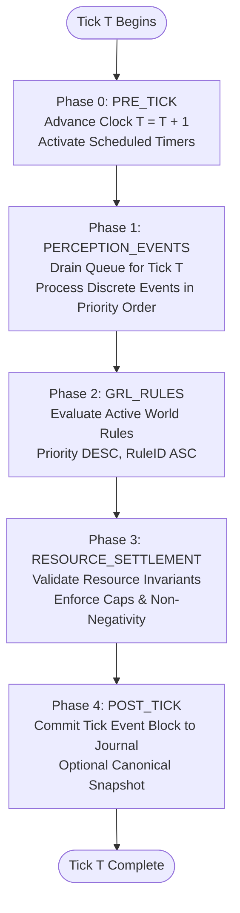

# GENESIS Alpha — Time Model Specification

**Version:** 3.0  
**Phase:** Phase 0 (Architecture & Foundations)  
**Status:** Alpha Scope Locked · Runtime Frozen  

---

## 1. Discrete Time Foundations

Time in GENESIS is purely discrete, monotonic, and quantified in integer units called **ticks**. There is no continuous time, sub-tick micro-stepping, or floating-point delta-time ($\Delta t$).

```yaml
simulation:
  tick_unit: day
  ticks_per_year: 365
  leap_years: false
```

### 1.1 Non-Negotiable Time Axioms
1. **One Tick = One Day:** Exactly one simulated day elapses per simulation tick.
2. **Standard 365-Day Year:** Exactly 365 ticks constitute one simulated year. Leap years are strictly disabled (`leap_years: false`).
3. **Integer Durations Only:** All timers, delays, lifespans, cooldowns, and historical stamps are stored and evaluated as integer ticks.
4. **Explicit Conversion Only:** The codebase strictly forbids combining or converting units implicitly. Whenever years or days are referenced, they must pass through explicit conversion functions:
   $$\text{ticks\_from\_days}(d) = d$$
   $$\text{ticks\_from\_years}(y) = y \times 365$$
   $$\text{years\_from\_ticks}(t) = \lfloor t / 365 \rfloor$$
   $$\text{day\_of\_year}(t) = t \pmod{365}$$

### 1.2 Canonical Duration Table

| Duration | Equivalent Ticks | Canonical Formula |
| :--- | :--- | :--- |
| **1 day** | 1 | $1 \times 1$ |
| **100 days** | 100 | $100 \times 1$ |
| **1 year** | 365 | $1 \times 365$ |
| **10 years** | 3,650 | $10 \times 365$ |
| **100 years** | 36,500 | $100 \times 365$ |
| **1,000 years** | 365,000 | $1,000 \times 365$ |

---

## 2. The Tick Execution Lifecycle

Each simulation tick advances through five sequential, deterministic phases:



### Phase 0: `PHASE_PRE_TICK`
- The simulation clock increments: $\text{tick} \leftarrow \text{tick} + 1$.
- Any pending rule installations scheduled for activation at $\text{tick}$ are moved from staging to active status.
- Periodic background timers (e.g., daily decay, annual age counters) generate tick events.

### Phase 1: `PHASE_PERCEPTION_EVENTS`
- The event queue is queried for events whose target execution tick equals the current tick.
- Events are drained in deterministic sort order:
  $$(\text{tick} \uparrow, \text{phase} \uparrow, \text{priority} \downarrow, \text{sequence\_id} \uparrow)$$
- Discrete event handlers update entity states and append transition records to the staging ledger.

### Phase 2: `PHASE_GRL_RULES`
- The GRL rule engine iterates through all active rules in the registry:
  $$\text{Rule Order} = (\text{priority} \downarrow, \text{rule\_id} \uparrow)$$
- Each rule executes in a sandboxed, metered context (resetting operation count and touched entity set).
- Valid mutations are applied transactionally.

### Phase 3: `PHASE_RESOURCE_SETTLEMENT`
- Resource balances across all global pools and entity reserves are audited:
  - Check non-negativity: $\forall p, \text{balance}(p) \ge 0$.
  - Check maximum capacity: $\forall p, \text{balance}(p) \le 9,223,372,036,854,775,807$.
- If an invariant is violated, the tick is halted with an `InvariantViolationError`.

### Phase 4: `PHASE_POST_TICK`
- All staged state mutations and emitted events from the tick are sealed into an immutable block in the `EventJournal`.
- The cumulative event journal hash is updated:
  $$H_{T} = \text{SHA-256}(H_{T-1} \,\|\, \text{CanonicalBytes}(\text{TickBlock}_T))$$
- If a snapshot interval is reached, a canonical snapshot of the entire world state (including PRNG registers) is written.

---

## 3. Event Scheduling and Temporal Offsets

Entities and rules can schedule events into the future using relative delay offsets:
```python
def schedule_event(
    event_type: str,
    delay_ticks: int,
    payload: dict,
    priority: int = 0
) -> EventRecord:
    if delay_ticks < 0:
        raise ValueError("delay_ticks cannot be negative")
    target_tick = current_tick + delay_ticks
    target_phase = PHASE_PERCEPTION_EVENTS
    seq_id = next_sequence_id()
    
    event = EventRecord(
        tick=target_tick,
        phase=target_phase,
        priority=priority,
        sequence_id=seq_id,
        event_type=event_type,
        payload=payload
    )
    event_queue.push(event)
    return event
```

- **Immediate Tick Execution:** If `delay_ticks == 0`, the event is scheduled for the next execution phase within the current tick (provided current phase $<$ target phase).
- **Future Execution:** If `delay_ticks > 0`, the event waits in the queue until `tick == current_tick + delay_ticks`.
- **Zero Retroactive Scheduling:** Target tick must always be $\ge \text{current\_tick}$. Scheduling an event in the past is an absolute runtime error.

---

## 4. Historical Immutability and Time Horizons

### 4.1 Temporal Integrity
- **Past ticks are permanently sealed:** Once tick $T$ finishes Phase 4 (`POST_TICK`), no entity state, property, or event log corresponding to tick $\le T$ can ever be overwritten, deleted, or re-ordered.
- **Rules apply prospectively:** A rule installed at tick $T$ has an activation tick $T_{\text{active}} \ge T + 1$. It can never retroactively re-simulate past days.

### 4.2 Numerical Range of Simulation Clock
The clock tick counter is a 64-bit unsigned integer:
$$\text{Max Ticks} = 2^{64} - 1 \approx 1.84 \times 10^{19} \text{ ticks}$$
At 365 ticks per year, this provides a simulation horizon exceeding $5 \times 10^{16}$ simulated years—vastly exceeding any practical simulation requirements while completely eliminating integer overflow vulnerabilities.
